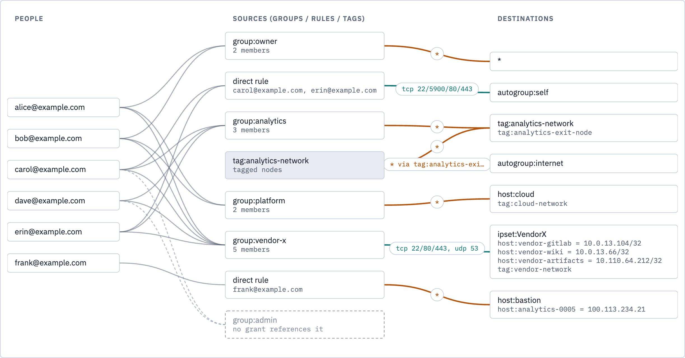

# Tailnet ACL Map

Paste a [Tailscale ACL](https://tailscale.com/kb/1018/acls) and see who reaches what, on which ports.

**Live:** https://hache.xyz/tailnet-acl-map/

## What it shows

- **Graph** of people → sources (groups, direct rules, tags) → destinations, with the allowed ports on each edge. Hover or tap a node to isolate its paths.
- **Per person** table with the effective reach of every user.
- **Tailscale SSH**, **tag owners** (plus what each tag auto-approves) and **hosts** tables.
- **Problems**: parse errors with line and column, invalid IPs and CIDRs, CIDRs with host bits set, ports out of range, references to groups, hosts, ipsets or tags that are not defined, legacy `acls` destinations without a port, empty groups, non-user group members.
- **Findings** computed from the policy: groups no grant uses, wildcard grants, users outside any group, tags with no owners, unreferenced hosts, Funnel, and CIDR overlaps (a port-restricted host that sits inside a wider all-ports destination).

Supports the `grants` syntax and legacy `acls`, `ipsets`, `hosts`, `tagOwners`, `autoApprovers`, `ssh`, `nodeAttrs` and `tests`. HuJSON (comments, trailing commas) is accepted.

## Privacy

A single static `index.html`. Parsing and rendering happen in your browser; the policy is never sent anywhere. Clone it and open the file locally if you prefer.

## Tested against

The Tailscale docs samples (ACL syntax, ACL samples, grants, Tailscale SSH) and the headscale policy test corpus (125 policies, including deliberately malformed ones) all parse and render without errors.

## Limitations

- `autogroup:*`, `tag:*` and CIDR sources are drawn as nodes without members; devices are not resolved.
- Deny rules in legacy `acls` are ignored (Tailscale ACLs are allow-only).
- The overlap check only compares literal CIDRs and `host:` aliases; it does not know which routes your subnet routers actually advertise.

## License

MIT
